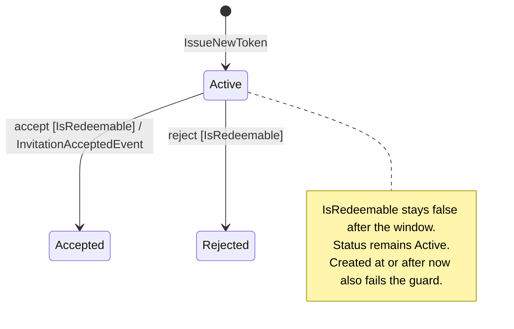
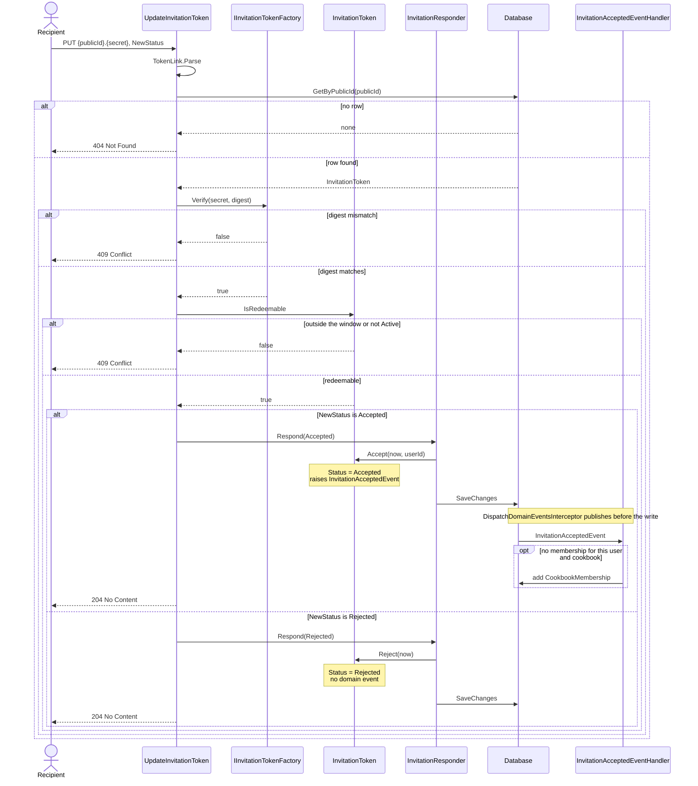

# Cookbook share link

A cookbook owner can generate a **shareable link** so someone else can join the cookbook without a prior email invite. This is separate from **email invitations** (`CookbookInvitation`), which target an existing user by email.

Share links use **InvitationToken** rows: a public id plus a secret, with only a hash stored in the database.

## Two invitation models

| Mechanism | Entity | How it works |
|-----------|--------|----------------|
| Email invite | `CookbookInvitation` | Owner invites by email; recipient must already be a registered user. CRUD under `/api/invitations`. |
| Share link | `InvitationToken` | Owner mints a link; anyone with the link (and a logged-in account) can preview and accept. `/api/invitationtokens`. |

This doc covers **share links** only.

## Flow

1. **Mint** - Owner calls `POST /api/invitationtokens` with a cookbook id. [CreateInvitationToken](../../src/Application/InvitationTokens/Commands/CreateInvitationToken/CreateInvitationToken.cs) uses [IInvitationTokenFactory](../../src/Application/Common/Interfaces/IInvitationTokenFactory.cs) to generate a secret and store `TokenDigest` (hash + salt). Response includes the full link string: `{publicId}.{secret}` ([TokenLink](../../src/Application/Common/Interfaces/IInvitationTokenFactory.cs)).
2. **Preview** - Recipient (authenticated) calls `GET /api/invitationtokens/{token}` to see cookbook title, image, and sender before accepting.
3. **Redeem** - Recipient calls `PUT /api/invitationtokens/{token}` with accept/reject. [UpdateInvitationToken](../../src/Application/InvitationTokens/Commands/UpdateInvitationToken/UpdateInvitationToken.cs) parses the link, verifies the secret against the stored hash, checks the token is still redeemable, then [IInvitationResponder](../../src/Application/Common/Interfaces/IInvitationResponder.cs) updates status.
4. **Membership** - On accept, `InvitationAcceptedEvent` runs; [InvitationAcceptedEventHandler](../../src/Application/Invitations/EventHandlers/InvitationAcceptedEventHandler.cs) adds a `CookbookMembership` if one does not already exist.

Endpoints: [InvitationTokens.cs](../../src/Web/Endpoints/InvitationTokens.cs). All routes require authorization - the recipient must be logged in to preview or accept.

## Token lifecycle

`InvitationToken.IssueNewToken` enters `Active`. Accept and reject are the only transitions out, and both are guarded by `IsRedeemable` (`Active`, and `Created` strictly inside the past 14 days). A failed guard leaves the row `Active`. `Accepted` and `Rejected` are terminal: `Accept` and `Reject` do nothing unless the current status is `Active`.

`Revoked`, `Error`, and `Unknown` exist on `InvitationStatus`. This command never writes them. [InvitationResponder](../../src/Infrastructure/InvitationResponder.cs) throws `NotSupportedException` for any decision other than accept or reject (a repeat of the current status returns without a write).

On accept, [InvitationAcceptedEventHandler](../../src/Application/Invitations/EventHandlers/InvitationAcceptedEventHandler.cs) adds a `CookbookMembership` when that user does not already belong to the cookbook. Reject raises no domain event.

## Redeem sequence

`PUT /api/invitationtokens/{token}` runs the checks in this order. Digest verification and the 14-day window are separate: the factory only compares the secret, then the handler reads `IsRedeemable`. Preview (`GET`) loads by public id and returns the cookbook summary; the secret and `IsRedeemable` are checked on this redeem path.

`SaveChanges` publishes domain events in `DispatchDomainEventsInterceptor` before the write, so the membership insert joins that same save. `TokenDigestMismatchException` and `TokenIsNotRedeemableException` are both `ConflictException` (409).

## Security model

- Raw secret is **never persisted** - only SHA-256(salt ‖ code) via [Sha256TokenFactory](../../src/Infrastructure/Security/Sha256TokenFactory.cs).
- Verification uses constant-time comparison.
- [InvitationToken](../../src/Domain/Entities/InvitationToken.cs) enforces **active** status and a **14-day** window from creation (`IsRedeemable`).

TTL and status checks are separate from cryptography; both must pass to redeem.

## Where to look in code

| Area | Path |
|------|------|
| Endpoints | [src/Web/Endpoints/InvitationTokens.cs](../../src/Web/Endpoints/InvitationTokens.cs) |
| Mint / redeem commands | [src/Application/InvitationTokens/](../../src/Application/InvitationTokens/) |
| Token format + factory interface | [IInvitationTokenFactory.cs](../../src/Application/Common/Interfaces/IInvitationTokenFactory.cs) |
| Hashing | [Sha256TokenFactory.cs](../../src/Infrastructure/Security/Sha256TokenFactory.cs) |
| Accept -> membership | [InvitationResponder.cs](../../src/Infrastructure/InvitationResponder.cs), [InvitationAcceptedEventHandler.cs](../../src/Application/Invitations/EventHandlers/InvitationAcceptedEventHandler.cs) |
| Email-based invites (other path) | [src/Web/Endpoints/Invitations.cs](../../src/Web/Endpoints/Invitations.cs), [CreateInvitation](../../src/Application/Invitations/Commands/CreateInvitation/CreateInvitation.cs) |
