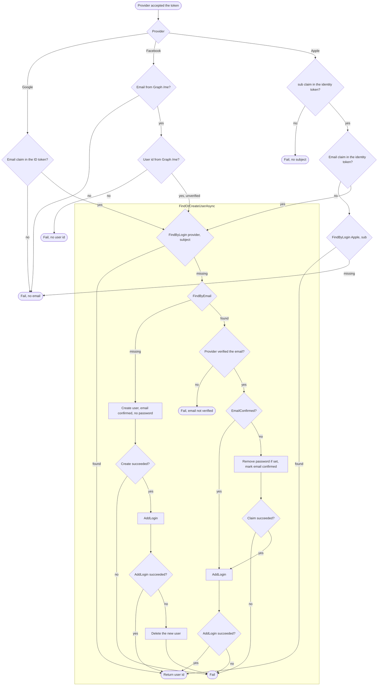

# Social sign-in

Users sign in with **Google**, **Apple**, or **Facebook** from the mobile app. Each provider returns a token to the client; the API validates that token, finds or creates a local user, and issues an **ASP.NET Core Identity bearer** session (same scheme as password login).

There is no separate “OAuth redirect” flow in this API - the app obtains provider tokens natively and posts them to dedicated login endpoints.

## Flow

1. Mobile SDK completes provider sign-in and yields an ID token (Google/Apple) or access token (Facebook).
2. Client calls one of:
   - `POST /api/users/login-google`
   - `POST /api/users/login-apple`
   - `POST /api/users/login-facebook`
3. Command handler ([LoginWithGoogle](../../src/Application/Users/Commands/LoginWithGoogle/LoginWithGoogle.cs), etc.) calls [ExternalLoginService](../../src/Infrastructure/Identity/ExternalLoginService.cs).
4. Service validates the token with the provider, then [ExternalAccountLinker](../../src/Infrastructure/Identity/ExternalAccountLinker.cs) **finds or creates** the user:
   - Existing external login -> return user id
   - Existing email, new provider -> link login, but only if the provider verified the email (Google `email_verified`, Apple `email_verified`; Facebook gives no signal, so it never links to an existing account). If the existing account was never confirmed, its password is removed and the email is marked confirmed, because whoever set that password never proved they own the address.
   - New user -> create account with confirmed email and no password (they can add one later through forgot password)
5. [SignInPrincipalFactory](../../src/Infrastructure/Identity/SignInPrincipalFactory.cs) builds claims; endpoint returns `Results.SignIn` with `IdentityConstants.BearerScheme`.

Endpoints are in [Users.cs](../../src/Web/Endpoints/Users.cs). Standard Identity registration/password routes also exist via `MapIdentityApi<ApplicationUser>()`.

## Account resolution

The chart starts once [ExternalLoginService](../../src/Infrastructure/Identity/ExternalLoginService.cs) has accepted the token from the provider. Google’s ID token passed `GoogleJsonWebSignature.ValidateAsync` with this server’s ClientId. Apple’s identity token passed signature, issuer, and bundle-id checks against Apple’s OIDC keys. Facebook’s access token passed `debug_token` (`is_valid` and this app’s id). A missing token, a bad signature, or the wrong app stops before the chart. Google, Facebook, and Apple-with-email then call [FindOrCreateUserAsync](../../src/Infrastructure/Identity/ExternalAccountLinker.cs). Apple with no email returns the user already stored for that `sub`, or it fails. Facebook enters the shared lookup with `isEmailVerified: false`. Google and Apple pass `email_verified` from the token.

Google is the Gmail / Google sign-in path. It joins the shared lookup once the ID token contains an email. An existing login for that provider and subject returns immediately, so a later sign-in still resolves when the token omits the email. Linking onto an address that already has an account requires `email_verified`, which is why Facebook stops at that decision. When the local account is still unconfirmed, the verified provider login removes its password and marks the email confirmed before `AddLogin`. A new address becomes a confirmed account with no password. If `AddLogin` fails after that create, the new user is deleted.

## Provider validation (where complexity lives)

All logic is centralized in [ExternalLoginService.cs](../../src/Infrastructure/Identity/ExternalLoginService.cs):

| Provider | Validation approach |
|----------|---------------------|
| Google | `GoogleJsonWebSignature.ValidateAsync` - audience must match configured ClientId |
| Apple | JWT validated against Apple’s OIDC metadata (`appleid.apple.com`); audience is app bundle id |
| Facebook | `debug_token` to verify app + token, then Graph API `/me` for id and email |

Google and Facebook require an email. Apple includes email only on the first authorization; later sign-ins are matched by the Apple subject (`sub`) on the existing external login. A brand-new Apple user with no email in the token cannot be created.

## Configuration

Per-provider options under `Authentication` in config (see [appsettings.Development.json](../../src/Web/appsettings.Development.json) for shape):

- `Authentication:Google:ClientId`
- `Authentication:Apple:BundleId`
- `Authentication:Facebook:AppId` / `AppSecret`

Production values are Fly secrets (`Authentication__Google__ClientId`, etc.) - [fly.md](../deploy/fly.md#secrets).

**The ClientId / bundle id on the server must match what the mobile app uses** when requesting tokens. Mismatch is the most common “invalid token” failure in dev.

## Where to look in code

| Area | Path |
|------|------|
| Endpoints | [src/Web/Endpoints/Users.cs](../../src/Web/Endpoints/Users.cs) |
| Commands | [src/Application/Users/Commands/LoginWith*/](../../src/Application/Users/Commands/) |
| Token validation + user provisioning | [ExternalLoginService.cs](../../src/Infrastructure/Identity/ExternalLoginService.cs) |
| Options types | [GoogleAuthOptions](../../src/Infrastructure/Identity/GoogleAuthOptions.cs), [AppleAuthOptions](../../src/Infrastructure/Identity/AppleAuthOptions.cs), [FacebookAuthOptions](../../src/Infrastructure/Identity/FacebookAuthOptions.cs) |
